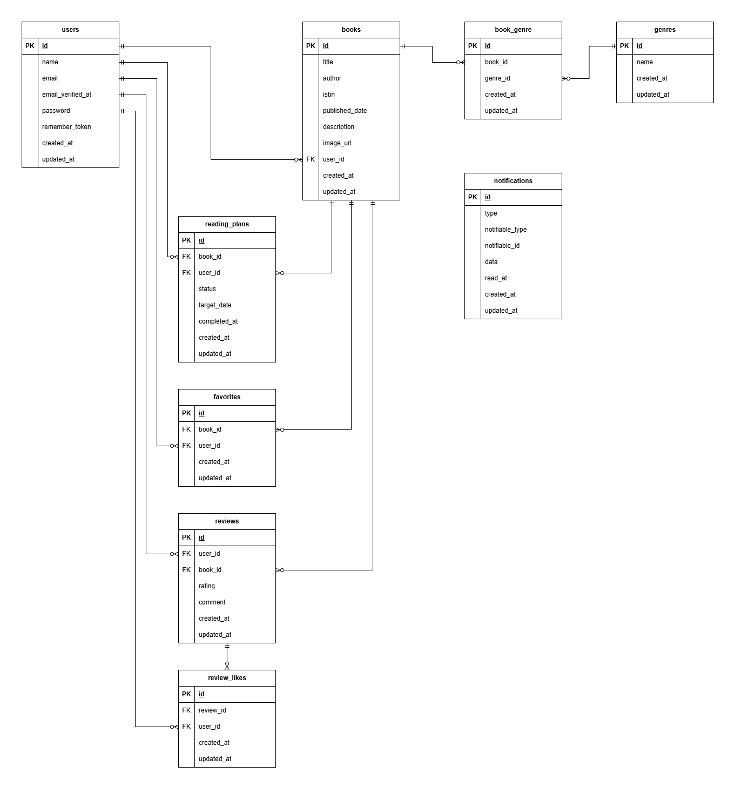

# bookshelf-app

## プロジェクト名
COACHTECH 書籍レビューアプリ BookShelf

## 概要
COACHTECHの模擬案件テストとして作成した成果物です。
書籍の登録を行うことができ、書籍一覧から各ユーザーが登録した書籍を確認することができます。
書籍に対してユーザーはお気に入りの登録やレビュー、いいね等を行うことができます。
また、ユーザーは読書計画を作成することができ、読書のスケジュールを組むことができます。

## ER図


## 環境構築手順

1. **プロジェクトの配置場所へ移動**
    ```bash
    mkdir laravel-practice
    cd laravel-practice
    ```

2. **リポジトリをクローン**
    ```bash
    git clone https://github.com/Hayashi-0506/bookshelf-app.git bookshelf-app
    cd bookshelf-app
    ```

3. **Composerパッケージをインストール**
    Laravel Sail も `composer.json` に含まれているため、このコマンドでまとめてインストールされます。
    ```bash
    docker run --rm \
        -u "$(id -u):$(id -g)" \
        -v "$(pwd):/var/www/html" \
        -w /var/www/html \
        -e COMPOSER_CACHE_DIR=/tmp/composer_cache \
        laravelsail/php82-composer:latest \
        composer install
    ```

4. **環境設定ファイルを作成**
    ```bash
    cp .env.example .env
    ```
    `.env` を開き、データベース接続情報を以下のように変更します。
    ```bash
    DB_CONNECTION=mysql
    DB_HOST=mysql
    DB_PORT=3306
    DB_DATABASE=laravel
    DB_USERNAME=sail
    DB_PASSWORD=password
    ```

5. **Sailの起動とエイリアス設定**
    - Sailをバックグラウンドで起動
        ```bash
        ./vendor/bin/sail up -d
        ```
    - エイリアスを設定して `sail` だけでコマンドを実行できるようにする（zsh の場合）
        ```bash
        echo "alias sail='[ -f sail ] && bash sail || bash vendor/bin/sail'" >> ~/.zshrc
        ```
    - bash の場合
        ```bash
        echo "alias sail='[ -f sail ] && bash sail || bash vendor/bin/sail'" >> ~/.bashrc
        ```
    - シェルを再起動するか、新しいターミナルを開いてエイリアスを有効にする
        ```bash
        exec $SHELL
        ```

6. **アプリケーションキーの生成**
    ```bash
    sail artisan key:generate
    ```

7. **データベースのマイグレーションと初期データ投入**
    ```bash
    sail artisan migrate --seed
    ```
    既存のデータベースをリセットしたい場合は以下を実行してください。
    ```bash
    sail artisan migrate:fresh --seed
    ```

8. **フロントエンドのセットアップ（Vite / Tailwind CSS）**
    Tailwind CSS などのパッケージは `package.json` に含まれているため、インストールとビルドのみ行います。
    ```bash
    sail npm install
    sail npm run build
    ```
    開発中にCSSやJavaScriptの変更を即時反映したい場合は、`sail npm run build` の代わりに `sail npm run dev` を実行したままにしてください。

## テストアカウント
`sail artisan migrate --seed` で以下のユーザーが作成されます（パスワードはすべて `password`）。

| 名前 | メールアドレス | 備考 |
|---|---|---|
| 山田太郎 | yamada@example.com | 読書計画・通知の確認用（主要シナリオを集約） |
| 鈴木花子 | suzuki@example.com | 他ユーザーの認可確認用 |
| 田中一郎 | tanaka@example.com | |
| 佐藤美咲 | sato@example.com | |
| 高橋健太 | takahashi@example.com | |

## 開発環境URL
- 書籍一覧画面：http://localhost/books
- ログイン画面：http://localhost/login
- 会員登録画面：http://localhost/register
- phpMyAdmin：http://localhost:8080

## APIエンドポイント一覧
| メソッド | URL | 認証 | 内容 |
|---|---|---|---|
| GET | /api/v1/books | 不要 | 書籍一覧（`keyword`・`genre_id`・`per_page`・`page` で絞り込み・ページ指定） |
| GET | /api/v1/books/{id} | 不要 | 書籍詳細 |
| POST | /api/v1/books | 必要 | 書籍登録 |
| PUT | /api/v1/books/{id} | 必要 | 書籍更新（登録者本人のみ） |
| DELETE | /api/v1/books/{id} | 必要 | 書籍削除（登録者本人のみ） |

認証が必要なAPIは、Sanctum のトークンを `Authorization: Bearer {トークン}` ヘッダーに付けて送信します。動作確認用のトークンは以下で発行できます。
```bash
sail artisan tinker --execute="echo App\Models\User::first()->createToken('api')->plainTextToken;"
```

## ISBNから書籍情報を自動入力
書籍登録画面では、ISBNを入力すると Google Books API から書籍情報を取得してフォームに自動入力できます。

API キーを付けずに Google Books API を使うと、1回目のリクエストから 429（利用上限超過）になる場合があります。以下の手順で API キーを取得して設定してください。

1. Google Cloud Console でプロジェクトを作成する
2. 「API とサービス」→「ライブラリ」で Books API を検索して「有効にする」
3. 「認証情報」→「認証情報を作成」→「API キー」でキーを作成する（アプリケーションの制限で「HTTP リファラー」を選ぶとサーバーからのリクエストが拒否されるため、「なし」または「IP アドレス」を選択してください）
4. `.env` に設定する
    ```bash
    GOOGLE_BOOKS_API_KEY=作成したキー
    ```
5. 設定のキャッシュを消す
    ```bash
    sail artisan config:clear
    ```

## 読書計画のバッチ処理
毎日20:00に以下の処理が実行されます。
- 期日を過ぎた進行中の読書計画を「期限切れ」に更新
- 期日3日前・当日の進行中の計画、期日3日後の期限切れの計画にリマインド通知を送信

本番環境では、cron に以下を登録してスケジューラーを毎分実行します。
```bash
* * * * * cd /path/to/bookshelf-app && php artisan schedule:run >> /dev/null 2>&1
```

開発環境では、以下のコマンドで動作を確認できます。
```bash
# スケジューラーを起動したままにする（cron の代わり）
sail artisan schedule:work

# 20:00 を待たずに今すぐ実行する
sail artisan reading-plans:process
```

シーダーは実行日を起点に期日を設定しているため、`sail artisan migrate:fresh --seed` の直後に `sail artisan reading-plans:process` を実行すると、山田太郎のアカウントで期限切れ化と3種類の通知を確認できます（シーダーとコマンドは同じ日に実行してください）。

## テスト
テストは SQLite（インメモリ）で実行されるため、MySQL のデータには影響しません。
```bash
sail artisan test
```

カバレッジを確認する場合（Xdebug または PCOV が必要）
```bash
sail artisan test --coverage
```

## 使用技術
- PHP 8.5
- Laravel 10.x
- MySQL 8.4
- フロントエンド：Vite、Tailwind CSS 3.4、Alpine.js
- 認証：Laravel Fortify、Laravel Sanctum
- 外部API：Google Books API
- 開発ツール：Docker、Laravel Sail、phpMyAdmin

## 開発者
- 林 佑一
